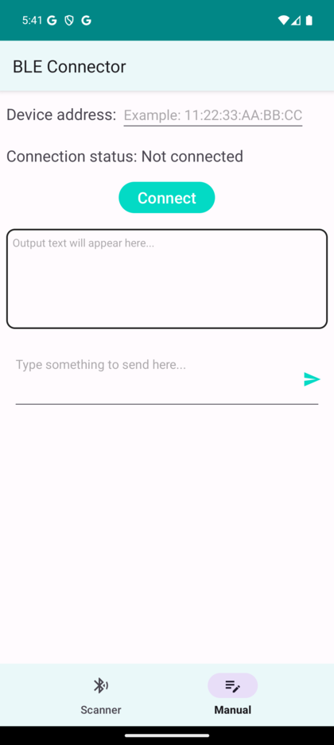

# BLEConnector

A Bluetooth Low Energy connector and scanner for Android.

<p align="center">
  
</p>

- **Scanner** tab lists nearby BLE devices.
- **Manual** tab connects to a device by its address (for example `11:22:33:AA:BB:CC`), shows the connection status, and lets you send text to the device and read its output.

The app asks for Bluetooth scan/connect and location permissions on first launch.

## Build and run

```sh
./gradlew assembleDebug
adb install -r app/build/outputs/apk/debug/app-debug.apk
```

Or open the project in Android Studio and run it on a device. A physical phone is needed to see real BLE devices.
